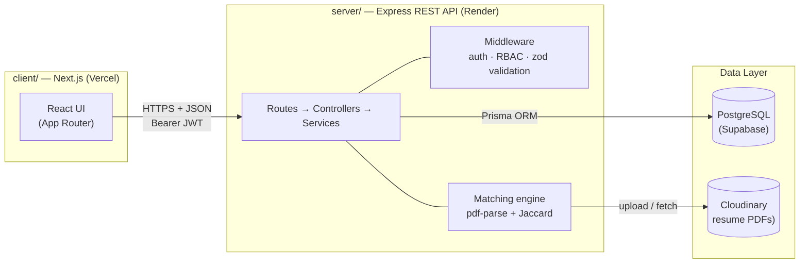

# PlaceMate — Campus Placement & Referral Portal

> Upload a PDF resume → skills are parsed → every job shows a deterministic **match score** → apply through a real hiring pipeline → the TPC admin filters everything and exports CSV reports.

PlaceMate is a multi-role placement portal for campuses. Students build an academic profile, upload a PDF resume (parsed automatically), and apply to eligible drives. Recruiters post jobs with eligibility rules and rank applicants by resume–JD similarity. The Training & Placement Cell admin sees every application with filters (`minCgpa`, `batch`, `branch`, `jobId`) and can export the report as CSV.

**Status:** Phase 0 complete — documentation set + both scaffolds are in place; the Express API boots with Prisma 7 + PostgreSQL adapter (verified). Next: **TASK-001** (install Git → first commit → push to GitHub).

---

## Architecture



Two deployables, one repository. The client never touches the database; the server never trusts the client. Full detail: [docs/ARCHITECTURE.md](docs/ARCHITECTURE.md).

## Tech stack

| Layer | Choice |
|---|---|
| Frontend | Next.js 16 (App Router) + TypeScript + Tailwind CSS v4 |
| Icons & forms | lucide-react · React Hook Form + zod |
| Backend | Node.js + Express 5 + TypeScript |
| ORM / DB | Prisma 7 (driver adapter) + PostgreSQL (Supabase) |
| Auth | JWT (7-day) + bcrypt — ADR-004 |
| Resume pipeline | Multer (memory, 5 MB, PDF-only) → pdf-parse → skill dictionary → Cloudinary — ADR-003 |
| Matching | Jaccard similarity, deterministic, no AI API — ADR-005 |
| Testing | Vitest + supertest (API) · Playwright (E2E) |
| Deploy | Vercel (client) + Render (server) |

## Quickstart

**Prerequisites:** Node.js 20+ and npm. (Git is needed for TASK-001; not required to run the apps.)

### 1. Server — Express API

```bash
cd server
npm install
npx prisma generate        # generates the client into src/generated/prisma/
npm run dev                # → http://localhost:5000/api/health
```

Create `server/.env` from `server/.env.example` and fill `DATABASE_URL` (Supabase) before running database commands.

### 2. Client — Next.js

```bash
cd client
npm install
npm run dev                # → http://localhost:3000
```

`client/.env.local` already points at `NEXT_PUBLIC_API_URL=http://localhost:5000`.

### Prisma 7 notes (read before touching the schema)

- The connection URL lives in `server/prisma.config.ts` (reads `DATABASE_URL`), **not** in `schema.prisma`.
- The generated client outputs to `server/src/generated/prisma/` — it is git-ignored; run `npx prisma generate` after cloning or editing the schema.
- The runtime requires a driver adapter: `new PrismaClient({ adapter })` with `@prisma/adapter-pg`.
- The server is ESM (`"type": "module"`) and imports use `.ts` extensions (tsconfig `rewriteRelativeImportExtensions`).

## Repository layout

```text
project/                    ← repo root (git init here — TASK-001)
├── client/                 ← Next.js app (App Router, Tailwind v4)
├── server/                 ← Express REST API
│   ├── prisma/schema.prisma    ← data model (single source of truth)
│   └── src/                    ← routes · controllers · services · middleware · lib
├── docs/                   ← PRD, ARCHITECTURE, DESIGN, TEST_PLAN, SECURITY, DECISIONS, MEMORY
├── .cursor/rules/          ← AI coding rules (general, frontend, backend, testing)
├── README.md               ← this file
├── TASKS.md                ← the build plan, task by task (Phases 0–8)
├── RULES.md                ← how humans + AI work on this repo
└── .env.example            ← canonical list of every env var
```

## Documentation map

| Doc | Answers |
|---|---|
| [docs/PRD.md](docs/PRD.md) | What are we building and why? |
| [docs/ARCHITECTURE.md](docs/ARCHITECTURE.md) | How is it structured? (data model, API surface, flows) |
| [docs/DESIGN.md](docs/DESIGN.md) | What does it look like? (design tokens, components) |
| [docs/TEST_PLAN.md](docs/TEST_PLAN.md) | How do we know it works? (unit → integration → E2E) |
| [docs/SECURITY.md](docs/SECURITY.md) | What must never break? (auth, uploads, secrets) |
| [docs/DECISIONS.md](docs/DECISIONS.md) | Why these choices? (9 ADRs) |
| [docs/MEMORY.md](docs/MEMORY.md) | Where did we leave off? (AI session hand-off) |
| [TASKS.md](TASKS.md) | What's next? (the only file that tracks progress) |

The `vibe-code/` folder next to this repo holds the workflow guide this project follows (docs → small tasks → structured prompts → tests → deploy).

## Roadmap

- [x] **Phase 0** — Documentation, repo layout, Next.js + Express scaffolds
- [ ] **Phase 1** — Git + GitHub, Supabase, Prisma wired to the database
- [ ] **Phase 2** — Auth & roles (JWT, RBAC, dashboards)
- [ ] **Phase 3** — Student profile + resume upload & parsing
- [ ] **Phase 4** — Jobs & matching engine (Jaccard)
- [ ] **Phase 5** — Applications pipeline & status tracking
- [ ] **Phase 6** — TPC admin portal + CSV export
- [ ] **Phase 7** — Testing & hardening
- [ ] **Phase 8** — Deployment (Render + Vercel)

## Demo accounts

_Placeholder — created by the seed script (`prisma db seed`) in TASK-054._

| Role | Email | Password |
|---|---|---|
| Student | — | — |
| Recruiter | — | — |
| TPC Admin | — | — |

## License

Planned: MIT.
