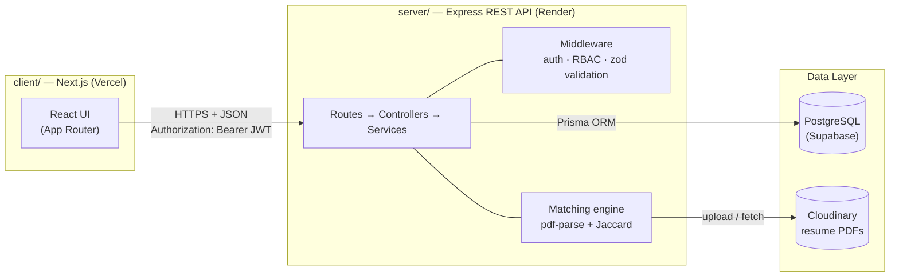
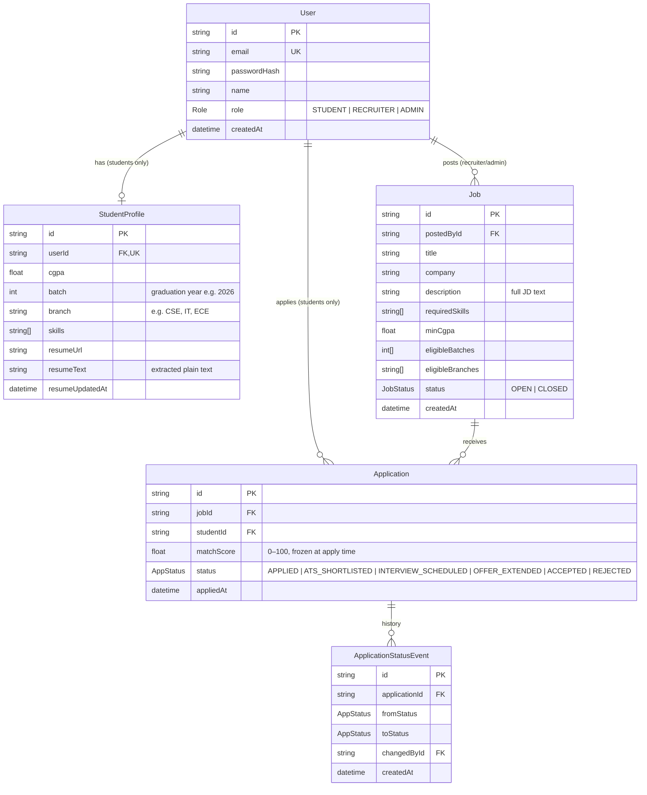

# Architecture — PlaceMate

| | |
|---|---|
| **Version** | 1.0 |
| **Date** | October 2026 |
| **Related** | `PRD.md`, `DECISIONS.md`, `SECURITY.md` |

> **Architecture = HOW.** This document is the plan-of-record. Do not change stack choices or directory conventions without adding an ADR to `DECISIONS.md` first.

---

## 1. System Overview



**Two separate deployables, one repository:**

- `client/` — Next.js app (App Router) that renders everything the user sees. Talks only to the API over HTTP.
- `server/` — Express REST API. Owns all business logic, auth, file parsing, database access. Never trusts the client.

## 2. Tech Stack (locked)

| Layer | Choice | Notes |
|---|---|---|
| Frontend | Next.js (App Router) + TypeScript | `client/` |
| Styling | Tailwind CSS | Follow `DESIGN.md` |
| Icons | lucide-react | |
| Forms | React Hook Form + zod resolver | Shared validation rules client-side |
| Backend | Node.js + Express + TypeScript | `server/` |
| Validation | zod (server-side, every mutating route) | API never trusts client input |
| ORM | Prisma 7 (driver adapter `@prisma/adapter-pg`) | Connection URL lives in `prisma.config.ts`; generated client in `src/generated/` (git-ignored); all DB access goes through services, never raw SQL |
| Database | PostgreSQL (Supabase hosted, free tier) | See ADR-002 |
| Auth | JWT (7-day access token) + bcrypt password hashing | See ADR-004 |
| File uploads | Multer (memory storage, 5 MB limit, PDF only) | |
| PDF parsing | pdf-parse | Extracts resume text |
| Storage | Cloudinary (resume PDFs) | See ADR-003 |
| Testing | Vitest + supertest (server), Playwright (E2E in `client/`) | |
| Deploy | Vercel (client) + Render (server) | See TASKS.md Phase 7 |

## 3. Runtime Topology

```text
Development                          Production
─────────────────────────            ─────────────────────────────────────
client  localhost:3000               client  placemate.vercel.app
   │  NEXT_PUBLIC_API_URL                │
   ▼                                     ▼
server  localhost:5000               server  placemate-api.onrender.com
   │  DATABASE_URL                      │
   ▼                                     ▼
Supabase PostgreSQL (cloud, both)    Supabase PostgreSQL (production project)
```

- CORS on the server allows exactly one origin: the client URL from `CLIENT_ORIGIN` env var.
- The same Supabase project is fine for dev and prod while learning; split before "real" launch (see guide Step 30).

## 4. Repository Structure

```text
project/                          ← repo root (git init here)
├── docs/                         ← planning & process docs (this folder)
│   ├── PRD.md  ARCHITECTURE.md  DESIGN.md  TEST_PLAN.md
│   ├── SECURITY.md  DECISIONS.md  MEMORY.md
├── .cursor/rules/                ← AI coding rules (general, frontend, backend, testing)
├── client/                       ← Next.js app
│   ├── src/
│   │   ├── app/                  ← routes (App Router)
│   │   ├── components/           ← reusable UI (design-system level)
│   │   ├── features/             ← feature-specific components & hooks
│   │   ├── lib/                  ← api client, helpers, constants
│   │   ├── types/                ← shared TypeScript types
│   │   └── utils/
│   └── e2e/                      ← Playwright tests (Phase 6)
├── server/                       ← Express API (ESM, NodeNext, `.ts`-extension imports)
│   ├── prisma/
│   │   └── schema.prisma         ← single source of truth for the data model
│   ├── prisma.config.ts          ← Prisma 7 CLI config (schema path + datasource URL)
│   ├── src/
│   │   ├── index.ts              ← entrypoint (starts HTTP server)
│   │   ├── app.ts                ← express app wiring (middleware + routes)
│   │   ├── generated/prisma/     ← generated Prisma client (git-ignored — `npx prisma generate`)
│   │   ├── routes/               ← route definitions only (no logic)
│   │   ├── controllers/          ← HTTP layer: parse req → call service → send res
│   │   ├── services/             ← business logic + ALL Prisma access
│   │   ├── middleware/           ← auth, requireRole, validate(zod), error handler
│   │   ├── lib/                  ← prisma client, jwt, cloudinary, matcher, skills
│   │   └── types/
│   ├── tests/                    ← vitest unit + supertest integration
│   └── .env                      ← real secrets (git-ignored)
├── README.md
├── TASKS.md
├── RULES.md
└── .env.example                  ← canonical list of every env var
```

## 5. Data Model

Single source of truth: `server/prisma/schema.prisma` (created in TASK-001).



**Schema rules:**

- Index every foreign key (`@@index([jobId])`, `@@index([studentId])`).
- `@@unique([jobId, studentId])` on Application — the database itself prevents duplicate applications.
- Enums live in Prisma; status strings never appear as loose text.
- `matchScore` is computed once at apply time and frozen (reproducible history).

## 6. API Surface (v1)

Base path: `/api`. All bodies JSON except the resume upload (multipart).

| Method | Endpoint | Access | Purpose |
|---|---|---|---|
| POST | `/api/auth/signup` | public | Register (role: STUDENT or RECRUITER only) |
| POST | `/api/auth/login` | public | Returns JWT + user object |
| GET | `/api/auth/me` | any auth | Current user + profile |
| GET | `/api/profile/me` | STUDENT | Get own academic profile |
| PUT | `/api/profile/me` | STUDENT | Update CGPA, batch, branch, skills |
| POST | `/api/profile/resume` | STUDENT | Upload PDF → parse → Cloudinary → save text |
| GET | `/api/jobs` | any auth | List jobs (students get eligibility + match score) |
| POST | `/api/jobs` | RECRUITER, ADMIN | Create job with JD + eligibility |
| GET | `/api/jobs/:id` | any auth | Job detail |
| PATCH | `/api/jobs/:id` | owner, ADMIN | Close/update job |
| POST | `/api/applications` | STUDENT | Apply (eligibility checked server-side) |
| GET | `/api/applications/me` | STUDENT | Own applications + status timeline |
| GET | `/api/jobs/:id/applicants` | owner, ADMIN | Ranked applicant list |
| PATCH | `/api/applications/:id/status` | owner, ADMIN, (student: accept only) | Advance pipeline |
| GET | `/api/admin/applications` | ADMIN | All applications + filters (`minCgpa`, `batch`, `branch`, `jobId`) |
| GET | `/api/admin/applications/export` | ADMIN | CSV download of the filtered list |
| GET | `/api/health` | public | Uptime check (used by Render) |

**Response convention:** `{ data: ... }` on success; `{ error: { message, details? } }` on failure. HTTP codes carry the truth (200/201/400/401/403/404/409/500).

## 7. Key Flows

### 7.1 Resume upload & parsing (the project's signature feature)

```text
Client: file input (PDF)
  → POST /api/profile/resume  (multipart, Authorization: Bearer JWT)
  → Multer memoryStorage, reject non-PDF or >5MB (400)
  → pdf-parse(buffer) → plain text
  → extract keywords: lowercase → tokenize → match against skill dictionary (skills.ts)
  → uploadStream to Cloudinary → resumeUrl
  → StudentProfile.resumeUrl + resumeText + resumeUpdatedAt saved
  → 200 with { resumeUrl, skills }
```

### 7.2 Match score (Jaccard similarity)

```text
resumeTokens = skills found in resumeText ∪ (job.requiredSkills ∩ resumeText)
jdTokens     = skills found in job.description  ∪ job.requiredSkills
score        = |resumeTokens ∩ jdTokens| / |resumeTokens ∪ jdTokens| × 100  (rounded to 1 dp)
```

- Live per-job preview on the jobs list uses the stored `resumeText`.
- The score stored on an Application is computed at apply time and never recalculated.
- Pure function in `server/src/lib/matcher.ts` → unit-testable without a DB (TASK-034).

### 7.3 Apply with eligibility enforcement

```text
POST /api/applications { jobId }
  → auth middleware (JWT valid, role = STUDENT)
  → profile exists, resume uploaded            else 400
  → cgpa >= job.minCgpa  AND batch ∈ job.eligibleBatches AND branch ∈ job.eligibleBranches
                                               else 403 "Not eligible"
  → no existing (jobId, studentId)             else 409 (also enforced by unique index)
  → compute matchScore → insert Application (status = APPLIED) + StatusEvent
```

### 7.4 CSV export

```text
GET /api/admin/applications/export?minCgpa=7.5&batch=2026&branch=CSE
  → same filter query as the list endpoint (single service function, no duplication)
  → build CSV string (header row + one row per applicant)
  → Content-Type: text/csv, Content-Disposition: attachment; filename="applicants-....csv"
```

## 8. Architectural Rules (binding)

1. **UI never talks to the database.** The client only fetches from the Express API.
2. **Routes are thin.** Logic lives in controllers (HTTP concerns) and services (business + Prisma).
3. **All database access lives in `server/src/services/`.** No `prisma.` calls anywhere else.
4. **Authorization is server-side, always.** Hiding a button is UX, not security. Every protected route re-checks the JWT and the role.
5. **Validate every mutating request with zod middleware** before it reaches the controller.
6. **Ownership checks happen in services** (e.g., a recruiter may only read applicants for jobs they posted).
7. **Pure logic is separated from I/O** (matcher, keyword extraction) so it can be unit-tested without mocks.
8. **One API client in `client/src/lib/api.ts`.** No scattered fetch calls; it attaches the JWT and unwraps errors.
9. **Types flow from one place.** Client request/response types live in `client/src/types/api.ts` and mirror the API contract above.
10. **No new dependencies** without asking (they must fit the stack table in §2).

## 9. Environment & Configuration

Every variable is declared in root `.env.example`. Actual values live in `server/.env` and `client/.env.local` (both git-ignored).

| Variable | Lives in | Purpose |
|---|---|---|
| `DATABASE_URL` | server | Supabase Postgres connection string (read by `prisma.config.ts` and `@prisma/adapter-pg`) |
| `JWT_SECRET` | server | Signs auth tokens (32+ random chars) |
| `JWT_EXPIRES_IN` | server | e.g. `7d` |
| `PORT` | server | `5000` |
| `CLIENT_ORIGIN` | server | CORS allowlist, e.g. `http://localhost:3000` |
| `CLOUDINARY_CLOUD_NAME` / `CLOUDINARY_API_KEY` / `CLOUDINARY_API_SECRET` | server | Resume storage |
| `SEED_ADMIN_EMAIL` / `SEED_ADMIN_PASSWORD` | server | Admin account for `prisma db seed` |
| `NEXT_PUBLIC_API_URL` | client | e.g. `http://localhost:5000` |

## 10. What Is Explicitly NOT in This Architecture (v1)

- No state-management library (React context + server components are enough)
- No Redis, no queues, no websockets, no microservices
- No AI API dependency (matching is deterministic — see ADR-005)
- No refresh-token rotation (single 7-day JWT; revisit in v2)
